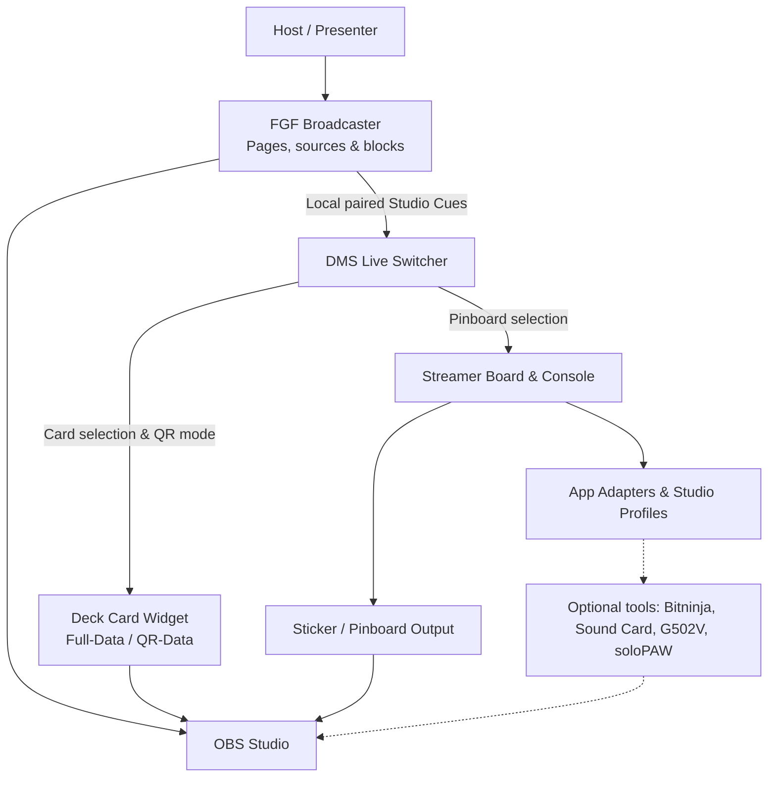

<div align="center">

# 🎛️ DigiMancer Streamer Apps
### DM-SBC-HB · Streamer Board & Console Resource Hub

**Build your studio around the show, not the other way around.**

*A focused directory, setup guide, and integration map for the DigiMancer3D local-first streaming toolkit.*

[](https://github.com/DigiMancer3D/DM-SBC-HB)
[](#design-principles)
[](#live-show-workflow)
[](#getting-started)

**[Start Here](#getting-started)** · **[Tool Directory](#tool-directory)** · **[Live Workflow](#live-show-workflow)** · **[Integration & Formats](#integration--formats)** · **[Troubleshooting](#troubleshooting)**

</div>

---

## What is DM-SBC-HB?

**DM-SBC-HB** is the focused **resource hub for Streamer Board & Console (SBC) and its companion studio applications**. It helps creators discover which tools do what, plan a working installation, and understand how the applications cooperate during a show.

This repository is **not itself the SBC desktop application**, and it is **not a combined installer or automatically synchronized monorepo**. Each linked application is developed and released independently. Install only what your setup needs.

| Repository | Purpose |
|:--|:--|
| **This repository ,  [DM-SBC-HB](https://github.com/DigiMancer3D/DM-SBC-HB)** | Focused SBC companion directory, recommended setup, and integration recipes |
| **[DMST](https://github.com/DigiMancer3D/DMST)** | Broader DigiMancer Streamer Tools ecosystem and documentation |
| **[Streamer-Board-Console](https://github.com/DigiMancer3D/Streamer-Board-Console)** | The actual local application dashboard, adapter manager, and pinboard control center |

> [!NOTE]
> This is a **living resource guide**, not a guarantee that every feature described here exists in every historical release. Check each application's own README and release files for dependencies, current behavior, and compatibility.

## At a glance

- 🎛️ **One studio, separate applications** ,  launch and coordinate tools without making them inseparable.
- 🎬 **Show-driven navigation** ,  FGF broadcaster pages can request deck cards, pinboards, and display modes through DMS.
- 🃏 **Dual presentation modes** ,  Deck Card Widget supports Full-Data and QR-Data display layouts and side-specific visual elements in newer builds.
- 🧷 **Live sticker and pinboard selection** ,  reusable SBC pinboards and deck-card overlays remain distinct outputs.
- 🐾 **Accessible controls** ,  compatible with one-handed and mouse-first workflows, including soloPAW and G502 input visualization.
- 📺 **OBS-aware output** ,  separate presentation/output windows simplify capture and compositing.
- 🔒 **Local-first handling** ,  user libraries, project files, tokens, and show-specific configurations remain on the user's machine unless explicitly published.

---

## Tool directory

### Core studio and show automation

| Tool | Role | Repository |
|:--|:--|:--|
| **Streamer Board & Console (SBC)** | Studio dashboard; launch adapters, profiles, pinboards, and editable app display names | [Streamer-Board-Console](https://github.com/DigiMancer3D/Streamer-Board-Console) |
| **DMS Live Switcher** | Lightweight live switching between registered SBC pinboards and Deck Card Widget collections; bridges FGF Studio Cues | [DMS-Live-Switcher](https://github.com/DigiMancer3D/DMS-Live-Switcher) |
| **Deck Card Widget (DCW)** | OBS-ready cards with text, emoji, PNG/sticker layers, saved collections, and Full-Data / QR-Data output | [Deck-Card-Widget](https://github.com/DigiMancer3D/Deck-Card-Widget) |
| **Field Guide Forge (FGF)** | Build structured episode guides, host/broadcaster pages, proof displays, and page/source/block Studio Cues | [Field-Guide-Forge](https://github.com/DigiMancer3D/Field-Guide-Forge) |
| **FGF Broadcaster Launcher (FGF-BCL)** | C++/Qt-based configurable launcher for finding the latest eligible private/broadcast FGF episode | See the [FGF project](https://github.com/DigiMancer3D/Field-Guide-Forge) |

### Creative production and accessibility companions

| Tool | Role | Repository |
|:--|:--|:--|
| **SWAR** ,  Script Writer and Reader | Structured `.script` authoring, reading, story arcs, and teleprompter-style workflows | [3DChangesPerspectives / SWAR](https://github.com/DigiMancer3D/3DChangesPerspectives/tree/main/SWAR) |
| **Bitninja Mocap Lite** | Local VTuber / VRM tracking and OBS-oriented motion capture | [Bitninja-Mocap-Lite](https://github.com/DigiMancer3D/Bitninja-Mocap-Lite) |
| **Sound Card** | Microphone-reactive visuals and audio-response overlays | [soundcard](https://github.com/DigiMancer3D/soundcard) |
| **G502 Visualizer** | On-screen Logitech G502 button, scroll, tilt and G-Shift activity | [G502V](https://github.com/DigiMancer3D/G502V) |
| **soloPAW** | One-handed / mouse-first control profiles, switcher, and controller-map tooling | [soloPAW](https://github.com/DigiMancer3D/soloPAW) |

**Independent tools remain independently useful.** A creator can use DCW without FGF, run FGF without DMS, or use SBC only as a launcher. Cross-application automation requires the relevant versions and local connections to be configured.

---

## Live-show workflow



### Example: changing slides during a show

1. The presenter opens a **host/broadcast** FGF page, not its public companion export.
2. FGF displays **PAIRED** once its local DMS connection is established. If not paired, it requests connection rather than silently assuming automation is available.
3. The presenter advances to another page (for example with **W** / **S**, or jumps with **A** / **D**).
4. When **Auto Cues** are enabled and a matching cue exists, FGF requests the assigned deck card, pinboard, or QR-data presentation from DMS.
5. DMS resolves the requested item against its registered local cards/pinboards and asks the appropriate application to change output.
6. OBS captures the resulting windows; no direct GitHub connection is needed during the show.

Cue assignment can be made at **page**, **source**, or **content-block** level. Unassigned elements leave the current studio output unchanged. A presenter can also disable Auto Cues for manual operation.

> [!IMPORTANT]
> The live connection is **not** a remote cloud service. The broadcaster and DMS must be reachable through the configured local integration, and some actions require a pairing code. **Public FGF `web` / `pub` / `git` outputs should not contain private pairing details or studio automation configuration.**

### Deck Card Widget: Full-Data and QR-Data

Newer DCW builds distinguish a detailed **Full-Data** layout from a visually focused **QR-Data** layout. Cards can have saved display preferences, while the operator or DMS can use a live QR-Data switch where supported.

- **Full-Data:** regular card text, links, and visual arrangement.
- **QR-Data:** larger QR or fitted fallback text, with dedicated areas for card information, show art, and sponsor artwork.
- **Dual-side artwork:** supported newer builds allow independent positioning, visibility, and Full-Data-only / QR-Data-only availability for visual objects.
- **Shared QR geometry:** collection-level QR layout controls can keep multiple cards visually consistent.

For the authoritative controls and file format, consult the [Deck Card Widget README](https://github.com/DigiMancer3D/Deck-Card-Widget).

---

## Getting started

### 1. Choose your applications

**Linux** is the primary documented setup, particularly for the Python/Tk utilities and local launchers. Some tools use web technology, Electron, or native C++/Qt; dependencies and platform support differ. Refer to each project's setup instructions instead of assuming one common installer works for all of them.

Suggested order for a connected FGF show:

1. **SBC** ,  register your apps and configure the desired pinboard collections.
2. **DCW** ,  configure a deck-card collection and test its OBS output.
3. **DMS** ,  connect the SBC pinboard and DCW card rails; test live switching.
4. **FGF** ,  import the relevant card identifiers, map Studio Cues, and pair a host/broadcast export with DMS.
5. Add **Bitninja**, **SWAR**, **Sound Card**, **G502V**, and **soloPAW** according to the show.

### 2. Create a companion-app workspace

```bash
mkdir -p "$HOME/SBC_Streamer_Apps"
cd "$HOME/SBC_Streamer_Apps"

# Clone only the applications you want:
git clone https://github.com/DigiMancer3D/Deck-Card-Widget.git
git clone https://github.com/DigiMancer3D/DMS-Live-Switcher.git
git clone https://github.com/DigiMancer3D/Field-Guide-Forge.git
```

SBC itself may live in a separate directory; its application adapters can be configured for that layout. **There is no requirement to clone all tools into the same location**, and this documentation repository does not automatically install them.

### 3. Keep personal libraries separate from application code

An example user-owned data layout:

```text
~/SBC_Streamer_Apps/
├── Deck-Card-Widget/           # Application source
├── DMS-Live-Switcher/          # Application source
├── Field-Guide-Forge/          # Application source
└── user_data/                  # Private, user-managed studio data
    └── buttstores/            # *.buttstore card collections
```

Some installations use a separate `~/Streamer-Board-Console/` application directory. SBC/DMS paths and application adapters should refer to the actual locations rather than relying on hardcoded example paths.

### 4. Configure the output windows in OBS

Capture the relevant DCW, pinboard, FGF broadcaster, or visualizer output using the capture method that works with your OS, display server, and OBS configuration. Keep private controls in their own windows when possible. Check sizing, chroma key, clipping, and scaling before a live episode.

---

## Integration & formats

| File / concept | Owned by | Used for |
|:--|:--|:--|
| `.buttstore` | Deck Card Widget | Collections of deck cards, saved styling and associated card data |
| `.deckbutt` | Deck Card Widget | Reusable individual deck-card data, where supported |
| `.sboard` | Streamer Board & Console | Saved sticker/pinboard sets |
| `.fgf` | Field Guide Forge | Editable Field Guide project, including supported Studio Cue mappings |
| `.script` / `.arcs` | SWAR | Script markup and story-arc materials |
| Host/broadcast FGF `.html` | FGF | Presenter-facing show page; may use local paired studio automation |
| Public FGF `.html` | FGF | Audience-facing companion export without local studio controls |
| `*_BCLaunch.sh` | FGF-BCL | Saved launcher that searches for an eligible show broadcaster page |

### Recommended automation boundaries

- **FGF decides what the presentation needs.** Its navigation can request a specific card, board, or display mode.
- **DMS validates and performs live switching.** Cards and pinboards must be recognized in DMS's configured collections.
- **DCW and SBC own their output and persistence.** They remain authoritative for the actual card/pinboard content.
- **SBC manages app discovery and startup.** Renaming an app's visible label should not require changing the internal adapter ID or its launch command.

This separation keeps show logic portable and reduces accidental coupling between unrelated application files.

### FGF-BCL and episode selection

FGF-BCL is intended to discover **private / host / broadcast** HTML pages in configured directories, prioritize the requested show, and select an eligible newest episode. It excludes public `web` / `pub` / `git` companion pages from the automation launch path. Generated launchers can be registered as SBC app commands.

Show identifiers and episode-number matching are configurable, so the same approach can support **3D Changes Perspectives**, **Define Thy**, or another producer's naming style. See the FGF project's actual FGF-BCL instructions for setup and build requirements.

---

## Keeping a live studio safe

> [!CAUTION]
> **Do not commit the contents of `user_data/`, `.buttstore`/`.sboard` episode collections, private `.fgf` projects, pairing codes, access tokens, OBS credentials, or filesystem backups to a public hub.** Review images, URLs, QR destinations, and personal episode information before publishing exported HTML.

- Back up app configuration and collection files before upgrading saved-data formats.
- Test **one** deck card and **one** pinboard change before running an entire automated episode.
- Keep a rollback copy of a working version, especially when applying incremental compatibility patches.
- Avoid committing machine-specific paths from generated launch scripts or Studio Profiles.
- Public FGF exports and private broadcaster pages are different deliverables; publish the appropriate one.

## Troubleshooting

<details>
<summary><strong>FGF navigation works, but deck cards do not change</strong></summary>

1. Confirm the host/broadcast FGF page shows **PAIRED** with DMS.
2. Confirm **Auto Cues** is enabled.
3. Confirm the selected page/source/block has a saved cue.
4. Confirm the assigned card or board is registered in DMS, and that DCW/SBC is running.
5. Test an explicit DMS switch before investigating the FGF mapping.

</details>

<details>
<summary><strong>The correct deck card loads, but QR-Data does not appear</strong></summary>

Check both the card's saved display preference and the live QR-Data state. Some versions let the live controller override ordinary cards without changing explicitly pinned QR-data cards. Check that the running DCW and DMS releases support the same bridge behavior.

</details>

<details>
<summary><strong>FGF opens in the wrong browser or cannot discover buttstores</strong></summary>

Use the installed FGF launcher rather than opening its editor HTML as a standalone file when local library discovery is needed. Browser file pickers can remember their own last-used folder; a regular webpage cannot freely browse `$HOME` or force a file picker to a private directory.

</details>

<details>
<summary><strong>A generated SBC launcher displays the wrong name</strong></summary>

Where supported, use SBC's **Rename App** control to change the visible display name, keeping the internal adapter identifier and launch command intact.

</details>

<details>
<summary><strong>My show output looks different in OBS</strong></summary>

Check the selected FGF presentation view, fullscreen state, OBS capture source, canvas dimensions, window scaling, and DCW data mode. Verify the expected output window is being captured rather than the private editor.

</details>

---

## Companion repositories

| Resource | Link |
|:--|:--|
| Parent ecosystem hub | [DigiMancer Streamer Tools (DMST)](https://github.com/DigiMancer3D/DMST) |
| Streamer Board & Console application | [Streamer-Board-Console](https://github.com/DigiMancer3D/Streamer-Board-Console) |
| DMS switching app | [DMS-Live-Switcher](https://github.com/DigiMancer3D/DMS-Live-Switcher) |
| Deck Card Widget | [Deck-Card-Widget](https://github.com/DigiMancer3D/Deck-Card-Widget) |
| Field Guide Forge | [Field-Guide-Forge](https://github.com/DigiMancer3D/Field-Guide-Forge) |
| Script specification | [.script](https://github.com/DigiMancer3D/.script) |
| 3D Changes Perspectives | [3DChangesPerspectives](https://github.com/DigiMancer3D/3DChangesPerspectives) |
| Creator profile and other projects | [DigiMancer3D on GitHub](https://github.com/DigiMancer3D) |

## Design principles

**Local ownership.** Your studio files and configuration belong to you.

**Small, independent tools.** Run one app or connect a whole workflow.

**Show-first UX.** A broadcaster should be able to advance a page and trigger the correct visual state without hunting through consoles.

**Accessibility-conscious control.** Mouse-first and one-handed operation are design considerations, not afterthoughts.

**Clear boundaries.** Control apps, output widgets, authoring tools, and public companion pages each have different responsibilities.


---

<div align="center">

**Created by [DigiMancer3D](https://github.com/DigiMancer3D)** · **[3Dthe.ninja](https://3dthe.ninja)**

*Streamer Board & Console Resource Hub*

**Licensing:** Individual applications may use different licenses. Follow the license included in each tool's own repository; this hub does not override them.

</div>
